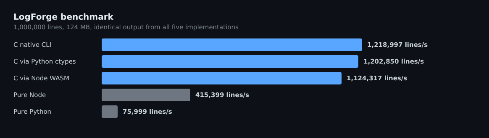
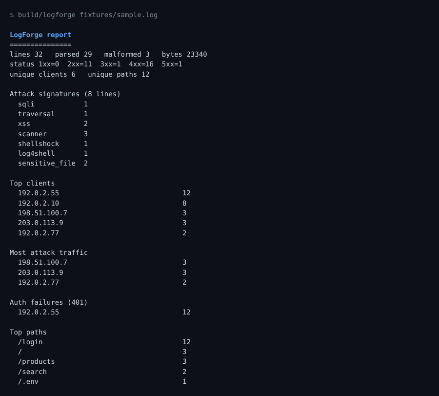

# LogForge

[](https://github.com/jvch0512/logforge/actions/workflows/ci.yml)

A web access log analyzer with **one C core and three front ends**: a native CLI, a Python binding (ctypes) and a Node binding (the *same C source* compiled to WebAssembly). It parses nginx and Apache combined logs, detects attack signatures (SQL injection, traversal, XSS, scanners, Shellshock, Log4Shell, sensitive file hunting), counts clients and paths, and flags brute force, at **over a million lines per second**.



> Built with AI assistance (Claude). Benchmarks below were measured on a 2-core cloud VM; your numbers will differ, the ratios should not.

## Why this design

- **No libc in the core.** `core/logforge.c` is freestanding C99 (no `malloc`, no `printf`, no `strlen`). That is what lets the identical source build for native, shared library and `wasm32-freestanding`.
- **Node without a native addon.** No `node-gyp`, no `ffi`: Node loads `logforge.wasm` (91 KB) with the standard `WebAssembly` API.
- **Python without a compiler at install time.** `ctypes` loads `liblogforge.so`.
- **Memory is bounded by construction.** Fixed hash tables (90,000 distinct clients, 45,000 distinct paths, overflow is counted and reported, never fatal), lines over 8 KiB are skipped, `lf_ctx` is a single allocation.

## Use it

```bash
make            # native CLI + shared library
make wasm       # WebAssembly build (pip install ziglang)

build/logforge access.log                       # human report
build/logforge --json access.log other.log      # machine readable, several files
cat access.log | build/logforge --fail-on-attacks   # exit 1 if any attack signature, for CI
```



```python
from logforge import LogForge          # bindings/python
with LogForge() as lf:
    lf.analyze_file("access.log")      # or lf.feed(bytes) in any chunking
    print(lf.report()["attackers"])
```

```js
import { LogForge } from "./bindings/node/logforge.mjs";
const lf = new LogForge();
lf.analyzeFile("access.log");
console.log(lf.report().attacks);
```

## What it detects

| Signal | Examples | Looked at |
|---|---|---|
| `sqli` | `union select`, `or 1=1`, `sleep(`, `information_schema` | decoded request target |
| `traversal` | `../`, `..%2f`, `/etc/passwd`, `boot.ini` | decoded request target |
| `xss` | `<script`, `onerror=`, `javascript:` (also percent-encoded) | decoded request target |
| `scanner` | sqlmap, nikto, nmap, masscan, gobuster, nuclei | User-Agent |
| `shellshock` | `() {` | target, User-Agent, Referer |
| `log4shell` | `${jndi:` | target, User-Agent, Referer |
| `sensitive_file` | `.env`, `.git/`, `wp-config`, `id_rsa` | path only, not the query string |
| `auth_failures` | 10 or more `401` responses from one client | status |

Matching is case-insensitive on the URL-decoded value (`%XX` and `+`), truncated to a fixed size so oversized input cannot cost more than a small constant.

## Benchmark

Same 124 MB synthetic log for every row (`bench/gen_log.py`, seeded), best of 3, wall clock including process start-up:

| Implementation | Time | Lines/s | MB/s | vs pure Python |
|---|---|---|---|---|
| C native CLI | 0.82 s | 1,218,997 | 151 | 16x |
| C via Python ctypes | 0.83 s | 1,202,850 | 149 | 16x |
| C via Node WASM | 0.89 s | 1,124,317 | 140 | 15x |
| Pure Node | 2.41 s | 415,399 | 52 | 5x |
| Pure Python | 13.16 s | 75,999 | 9 | 1x |

Two honest observations. The bindings add almost nothing, the work is in the core. And the WASM build is only about 8% slower than native, so shipping one core to Node is a real option. Reproduce with `make bench`. The C core still uses naive substring search; an Aho-Corasick automaton is the obvious next speed-up.

## Correctness: five implementations, one answer

`bench/ref.py` and `bench/ref.mjs` are independent pure-language implementations of the same rules. `make test` requires all five (C CLI, Python binding, Node/WASM binding and both references) to produce **byte-identical JSON** on a hand-written fixture and on 60,000 lines where 25% are hostile or malformed (bad dates, invalid UTF-8, 9 KB lines, CRLF, truncated escapes, backslash-escaped quotes).

Other checks:

- `tests/test_core.c`: 550 checks under AddressSanitizer and UBSan, including a hand-computed fixture, parser rejection cases, every detection rule, chunking at any size (1 byte up), over-long lines split across calls, binary garbage and table-capacity overflow.
- Python (`unittest`) and Node (`node:test`) suites for the bindings: chunking invariance, last line without newline, hostile bytes, independent contexts, use-after-close.
- Output is always valid JSON: any byte that is not printable ASCII is escaped as `\u00XX`, so an attacker cannot corrupt the report through a crafted request.

## Layout

```
core/       logforge.c/.h (freestanding), native.c (malloc), wasm_glue.c (WebAssembly exports)
cli/        command line front end
bindings/   python (ctypes) and node (WebAssembly)
bench/      log generator, pure-language references, benchmark runner
tests/      C unit tests, cross-implementation conformance
fixtures/   sample.log
```

## License

MIT
